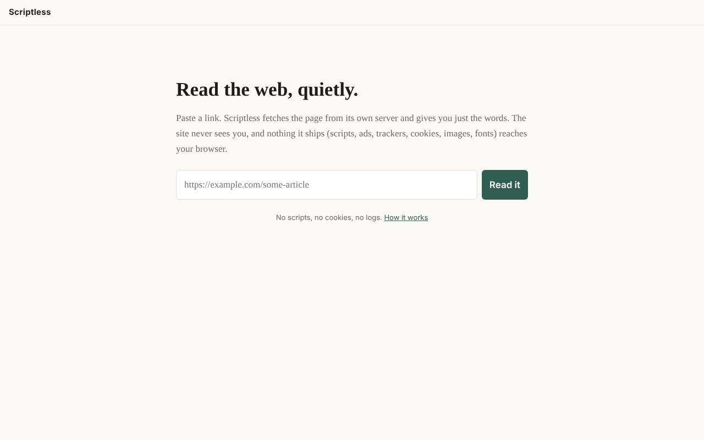

# Scriptless

<!-- site-screenshot: docs/screenshot.jpg -->


Paste a link, get only the words. Scriptless fetches a page on the server, pulls out the
readable article, and sends your browser a plain page of text. No scripts, ads, trackers,
cookies, images, fonts or frames from the original site ever reach you, and the site never
sees your IP address or browser.

## How it is deployed

```
GitHub Pages (static front door, no JS)  --POST url-->  Cloudflare Worker (fetch + extract)
                                                         returns the reading page itself
```

GitHub Pages can only serve static files, so it cannot fetch other sites. The Pages site is a
plain HTML landing page whose form posts to a small Cloudflare Worker. The Worker fetches the
article server-side, cleans it, and returns the reading page. The same code also runs as a
plain Node server if you would rather host it yourself.

### One-time setup

1. **Deploy the Worker** (free Cloudflare account):
   ```sh
   npm install
   npx wrangler login
   npm run deploy:worker
   ```
   Wrangler prints the address, e.g. `https://scriptless.<your-subdomain>.workers.dev`.
   In the Cloudflare dashboard, leave Workers Logs and Logpush off for this Worker
   (`wrangler.toml` already sets `observability.enabled = false`).
2. **Point Pages at it:** in the GitHub repo, go to Settings > Secrets and variables > Actions >
   Variables and add `SCRIPTLESS_WORKER_URL` with that address.
3. **Turn on Pages from Actions:** Settings > Pages > Build and deployment > Source:
   **GitHub Actions**. Then run the "Deploy site to GitHub Pages" workflow (or push to `main`).
4. **Optional, automatic Worker deploys:** add repository secrets `CLOUDFLARE_API_TOKEN`
   (a token with the "Edit Cloudflare Workers" template) and `CLOUDFLARE_ACCOUNT_ID`. Pushes to
   `main` that touch the app will then redeploy the Worker. Without them, that workflow skips.

## Run it locally

```sh
npm install
npm start            # Node server on http://127.0.0.1:8080
npm run dev:worker   # or the Worker, on http://127.0.0.1:8787
```

Or with Docker:

```sh
docker build -t scriptless .
docker run --rm -p 8080:8080 scriptless
```

Settings (environment variables): `PORT` (default 8080), `HOST` (default 127.0.0.1),
`MAX_CONCURRENT` (simultaneous page fetches, default 16).

Run the tests with `npm test`. To preview the Pages build against a local Worker:
`SCRIPTLESS_WORKER_URL=http://127.0.0.1:8787 npm run build:site`, then serve `_site/`.

## Privacy design

**Your browser** receives server-rendered HTML with zero JavaScript. Every response carries:

- `Content-Security-Policy: default-src 'none'; script-src 'none'; img-src 'none'; ...` plus a
  `sandbox`, so even a bug in the sanitizer cannot run code or load anything from another site.
  The only thing allowed is this app's own stylesheet.
- `Referrer-Policy: no-referrer`, `Cache-Control: no-store`, `X-Frame-Options: DENY`,
  COOP/COEP/CORP, and a `Permissions-Policy` that turns off sensors, FLoC and Topics.
- No `Set-Cookie`, ever. There are no accounts or sessions.

**The site being read** sees only the server (on Cloudflare, a Cloudflare address plus a
`CF-Worker` header naming the Worker's domain, never the reader's IP). Requests go out with a common Firefox user
agent, `DNT` and `Sec-GPC`, and no cookies, referrer or forwarding headers. Connections are
never reused between users. Tracking parameters (`utm_*`, `fbclid`, `gclid`, `msclkid`,
`mc_eid`, `_hsenc`, and many more; see `src/clean-url.js`) are removed before fetching, after
every redirect, and from every link in the article.

**The Pages front door** is static HTML with no JavaScript and a meta Content Security Policy
whose `form-action` allows only your Worker.

**The server** keeps nothing. There is no access log, no analytics, no cache and no database.
The main form uses POST so the address you read stays out of browser history and out of any
proxy logs in front of the app. Links inside articles open through Scriptless (as `GET
/read?url=...`) so following them stays private too. If you put Scriptless behind nginx,
Caddy or a CDN, turn off their access logs as well, or they will record those URLs.

**Content** goes through Mozilla's Readability (the engine behind Firefox Reader View), then
an allowlist sanitizer that keeps only text structure: headings, paragraphs, lists, quotes,
code, tables and links. Images become `[Image: description]`. Scripts, styles, iframes, SVG,
forms, inline event handlers and `javascript:` links are all dropped.

## Server-side request forgery protection

A public fetcher is an easy way to attack whatever network it runs on, so the fetcher:

- allows only `http`/`https` on ports 80 and 443;
- rejects `localhost`, `.local`, `.internal` and `.home.arpa` names;
- (Node server) checks every resolved address at **connect time** (so DNS rebinding cannot swap in a
  private address after validation) and refuses loopback, private, link-local (including
  cloud metadata at 169.254.169.254), carrier-grade NAT, multicast, reserved, IPv4-mapped
  IPv6, NAT64, 6to4 and Teredo ranges;
- re-validates every redirect hop (max 5);
- (Worker) relies on Cloudflare's runtime, which cannot reach private networks, on top of
  the same address and port checks;
- accepts only HTML responses, caps size at 5 MB and time at 10 seconds.

## Limits

Pages that build their text with JavaScript, or sit behind logins and paywalls, may come back
empty. Some sites block requests from data-center IPs.

## Layout

```
src/worker.js          Cloudflare Worker entry (fetch with redirect re-checks)
src/server.js          Node server entry
src/net.js             Node fetcher with connect-time DNS checks
src/target.js          shared URL and address rules
src/clean-url.js       tracking-parameter removal
src/extract.js         Readability (on linkedom) + allowlist sanitizer
src/render.js          server-rendered pages (no JS)
src/headers.js         security headers
scripts/build-site.js  builds the static GitHub Pages site into _site/
public/style.css       the only asset (light and dark)
.github/workflows/     CI, Pages deploy, Worker deploy
test/                  node:test suite
```
